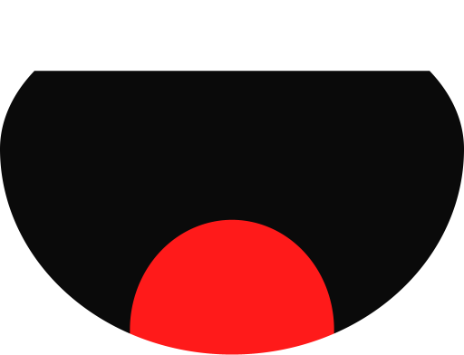
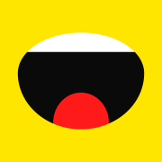
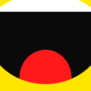
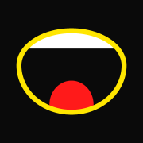
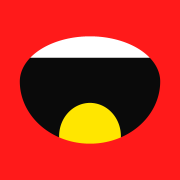
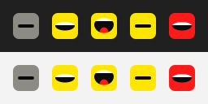

# Brand


ShoutAbout's brand comes from the owner's brand sheet ("ShoutAbout · Brand sheet", a first
pass). This page is the repo's working copy of it. It covers the mark, the palette, the type,
the app icons, the tray states and their animations, where the generated assets live, and how
to regenerate them.

**Say it out loud. It's typed on your PC.**

The voice is loud, short and literal, for example: *Press the Action Button and talk. Whisper
transcribes on your own GPU and pastes the text into whatever window has focus.* A notification
reads like this: `Pasted on your PC: "Push the release to Friday and tell the team."`

## The mark



The mark is an **open mouth**, set as the O in SHOUT. It has a black throat, a white strip of
top teeth that follows the curve, and a red tongue rising from the bottom. The lockup is
`SH`[mouth]`UT` on line 1 and `ABOUT` on line 2, all caps in Anton. The PC side never draws the
lockup, because it has no fonts. It draws only the mouth.

All mouth geometry is relative to a mouth box W × H. The reference box is 170 × 130 when the
mouth is open.

| Part | Geometry | Colour |
|---|---|---|
| Outline | CSS `border-radius: 50% / 42% 42% 58% 58%`. That is the **top half** of an ellipse (rx = W/2, ry = 0.42H) joined to the **bottom half** of another (rx = W/2, ry = 0.58H), both centred at (W/2, 0.42H). It is widest at 42 % of the height and deeper below than above. | Black `#0A0A0A` |
| Teeth | A band from the top edge down to 26/170 W (20 % of the open height), clipped to the outline. When the mouth is nearly shut, the band is capped at 55 % of H so that some throat always shows. | Teeth `#FFFFFF` |
| Tongue | An ellipse centred at (0.50W, 0.93H) with rx = 0.22W and ry = 0.31H, clipped to the outline. Its bottom sits 24 % of H below the box. It is painted under the teeth. | Tongue Red `#FF1A1A` |
| Openings | **Open** H = 130 (tongue out). **Ajar** H = 72, with the same width and no tongue. **Shut** is a black pill 62.4 % × 12.5 % of the tile, fully rounded. | |

**In marketing** (the website, store listings, social images, press), the owner's rule is
stricter than the app's: the only mouth shown is this primary mark, **open with its red
tongue**, and **never with a ring or outline** around it (so not the `dark` icon below, nor
the app's ringed record button or Live Activity). On a dark background it sits on a small
yellow tile, like the `primary` app icon, or on the yellow pill. Any talking animation stays
between open, tongue-out heights. See [launch/LAUNCH.md](launch/LAUNCH.md#press-kit-basics).

## Palette


| Name | Hex | Role |
|---|---|---|
| Shout Yellow | `#FFE600` | Ground and background |
| Black | `#0A0A0A` | Type, mouth and throat |
| Tongue Red | `#FF1A1A` | Accent, and the error tile |
| Teeth | `#FFFFFF` | Highlight |
| Starting Grey | `#8C8C84` | The tray's "starting" tile |
| Dark taskbar | `#202020` | Preview background |
| Paper | `#FAF9F5` | Light background |

The sheet's alternative "loud" grounds are blue `#1A2BFF`, magenta `#FF2E9A`, orange `#FF5A00`
and green `#3DFF3D`. They are for seasonal or beta variants (`brand.LOUD_GROUNDS`).

## Type

- **Anton** is for the logo and headlines. It is always UPPERCASE, with a line-height of about
  0.86 and letter-spacing of −0.01em.
- **Archivo** 500/700 is for body text and UI.
- **JetBrains Mono** 500/600 is for labels and captions, in uppercase with 0.1em tracking.

All three are Google Fonts under the **SIL Open Font License 1.1**. They are **not bundled** on
the PC side. Nothing the hub renders contains text, and Windows draws the tray menu and the
toasts with the system UI font. If a font is ever shipped (for example in a web page or an
installer), include its OFL license text with it.

## App icons

The app icons are full-bleed, opaque square artwork, because iOS masks the corners itself. They
come in 1024 px (App Store / Shortcuts) and 180 px (iPhone @3x). The sheet's 2 px inner stroke
is left out on purpose.

| | Variant | Look | Use |
|---|---|---|---|
|  | `primary` | Yellow tile, open mouth 78 % of the tile wide, centred | The default |
|  | `bleed` | Mouth 130 % wide (left −15 %, top −7 %), cropped by the edges | Louder: marketing and stickers |
|  | `dark` | Black tile, mouth 70 % wide, yellow lip ring 3.5 % of the tile | Dark mode |
|  | `alt` | Red tile, yellow tongue | Seasonal and beta builds |

## Tray states

The Windows notification-area icon is a rounded tile (radius 23 % of its size) whose mouth
shows what the hub is doing:

| | State | Hub status | Tile | Mouth | Motion |
|---|---|---|---|---|---|
|  | `starting` | `STARTING` | Grey | Shut | **Hums**: the pill squashes and stretches while the model loads |
|  | `idle` | `IDLE` | Yellow | Ajar: ready | Still |
|  | `transcribing` | `TRANSCRIBING` | Yellow | Open, tongue out | **Talks** (saTalk + saPunch) |
|  | `paused` | paused, not transcribing | Yellow | Shut | Still |
|  | `error` | `ERROR` | Red | Ajar | Still |



When several apply, the precedence is **error > starting > transcribing > paused > idle**
(`icons.icon_key`). A transcription that is already running keeps talking after you press
Pause, and the tooltip says "transcribing (paused)". The icon size is `SM_CXSMICON`: 16 px at
100 % scaling, 20 at 125 %, 24 at 150 % and 32 at 200 %. The hub is DPI aware, so the icons are
drawn at the real size and never scaled. At 48 px and below, the mouth width, the teeth line
and the shut pill are snapped to whole pixels, which keeps 16–24 px icons crisp.

## Animation

| Name | What | Timing |
|---|---|---|
| **saTalk** | Mouth-box height keyframes in px of 130: 0 % 130 · 10 % 58 · 22 % 118 · 32 % 40 · 44 % 130 · 54 % 84 · 64 % 124 · 74 % 46 · 86 % 108 · 100 % 130. The width stays fixed and the outline keeps its proportions. The tongue scales with the height. The teeth keep their depth. | 1.6 s, ease-in-out (`cubic-bezier(.42,0,.58,1)`) between keyframes, infinite |
| **saPunch** | Scale 1 → **1.07** at 44 % → 0.98 at 50 % → 1 at 60 %. It lands on saTalk's wide-open peak. The sheet's −2°/+1° rotation is below a pixel at tray size and isn't rendered. | 1.6 s, ease-out, infinite |
| **Hum** | The shut pill narrows by up to 28 % and thickens to match, on a cosine. | 1.6 s |

In the tray, `transcribing` plays **12 frames × 133 ms** and `starting` plays **8 frames ×
200 ms**. Each state's frames are rendered once per icon size (about 1 ms per frame at 24 px)
and turned into HICONs on first use. A `WM_TIMER` on the tray window then swaps them in with
`NIM_MODIFY`. The timer runs only while an animated state is showing. All HICONs are destroyed
when the tray stops.


## Where things live

| Path | What |
|---|---|
| `src/shoutabout/brand.py` | Palette, geometry and keyframe constants. A stdlib-only anti-aliased rasterizer (it supersamples convex shapes per sub-scanline, with exact horizontal coverage and no seams between shapes). The PNG / animated PNG writer, and the conversion to Windows icon resources (BITMAPINFOHEADER + BGRA + AND mask) and `.ico` files. |
| `src/shoutabout/icons.py` | Maps hub status and paused to a tray state. Builds the icon resources and HICONs for each state's frames. |
| `src/shoutabout/tray.py` | Shows them, and runs the animation timer. |
| `brand/app-icon/` | `{primary,dark,alt,bleed}-{1024,180}.png` |
| `brand/tray/` | `{starting,idle,transcribing,paused,error}-{16,32,64}.png` and `states-on-taskbars.png` |
| `brand/talk/` | Animated PNGs of the tray loops and the talking app icon, plus a strip of the talk frames |
| `brand/mouth-512.png`, `brand/palette.png` | The mark on its own, and the palette swatches |

## Regenerating

Everything in `brand/` is generated. Don't edit it by hand. After changing `brand.py`, run:

```powershell
.venv\Scripts\python.exe scripts\export_brand_assets.py
```

The script takes about a second and needs no Pillow. `tests/test_brand.py` fails if the
committed tray PNGs no longer match the renderer, or if `brand/` grows past 1.5 MB (it is
about 0.2 MB today). The animated PNGs play in browsers and on GitHub. Other viewers show the
first frame.

## Credits

The brand design (mark, palette, type choices, tray states and animations) comes from the
owner's brand sheet. The artwork in `brand/` is rendered from that geometry by
`scripts/export_brand_assets.py`. Anton, Archivo and JetBrains Mono are licensed under the SIL
Open Font License 1.1 and are not included in this repository.
